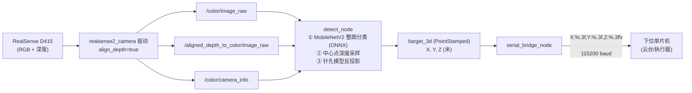

# AIC-2026-46559581 AI+农业 玉米医生 — RealSense 深度相机三维定位方案

> 对应代码包：`corn_ws/src/corn_detect`（`detect_node.py` / `serial_bridge_node.py` / `launch/detect.launch.py`）
> 运行平台：树莓派 4B/5 · Ubuntu 22.04 · ROS 2 Humble

---

## 1. 方案概述

**目标**：在树莓派边缘端接入 RealSense 类深度相机，对玉米叶片完成病害识别的同时，输出目标叶片在相机坐标系下的**三维坐标 (X, Y, Z)**，经串口实时下发给下位单片机，用于引导云台/末端执行器对准病叶。

**关键设计决策**：本项目的病害数据集为**图片级标注**（每张图只有一个"生病/健康 + 病害类别"标签，无病斑包围框），因此不做病斑级检测框定位，而是采用：

> **整图分类（判断生病/健康及病害种类） + 画面中心点深度反投影（求三维坐标）**

使用时操作者手持相机（或云台）将病叶对准画面中心，系统即输出该点三维坐标。该方案与现有分类模型完全配套，接口简单、计算量小（树莓派可实时运行），且后续升级为检测框定位时**下游接口完全不变**（见第 9 节）。

## 2. 硬件选型

| 部件 | 选型 | 说明 |
|---|---|---|
| 深度相机 | **Intel RealSense D415**（主选） | 主动双目 + RGB，出厂标定内参；0.3–3 m 深度量程贴合"手持近景看叶"场景；官方 ROS 2 驱动 `realsense2_camera` 对 Humble 支持完善 |
| 兼容型号 | D435 / D435i / D455 等 | 同一套代码直接可用，仅视场角/量程略有差异；其他品牌深度相机只要能发布"彩色图 + 对齐深度图 + 相机内参"标准话题，重映射话题即可接入 |
| 边缘计算 | 树莓派 4B/5（≥4 GB） | ONNX Runtime CPU 推理 MobileNetV2，单帧约 0.2–0.5 s，配合节流参数可流畅运行 |
| 下位机 | STM32 等任意单片机 | 通过 UART 接收 ASCII 坐标行，无需特殊协议栈 |

## 3. 系统架构与数据流



三个 ROS 节点职责单一、通过话题解耦：驱动节点由官方包提供，`detect_node` 负责"识别 + 定位"，`serial_bridge_node` 负责"下发"，任意一级都可独立替换调试。

## 4. 坐标系定义

`/target_3d` 采用**相机光学坐标系**（RealSense `color` 光学帧约定，与 OpenCV 一致）：

- 原点：彩色相机光心
- **X**：画面向右；**Y**：画面向下；**Z**：沿光轴向前（即目标距离）
- 单位：米；`PointStamped.header.frame_id` 写入驱动上报的 `camera_color_optical_frame`

若后续需要转换到云台/基座坐标系，只需在下位机或增加一个 `tf2` 静态变换节点做外参旋转平移，本方案输出的 Z 值即为目标直线距离，可直接用于云台俯仰/偏航解算。

## 5. 关键技术环节

### 5.1 深度—彩色对齐

RealSense 深度镜头与彩色镜头视场、光轴不同，像素不重合。启动驱动时必须开启 `align_depth:=true`，将深度图配准到彩色光轴，得到 `/aligned_depth_to_color/image_raw`，保证"彩色图上看到的点 = 深度图上同位置的值"。launch 文件中已默认开启。

### 5.2 目标点选取：画面中心

分类模型输出整图结论，无目标框，取**画面正中心像素 (u, v) = (W/2, H/2)** 作为病叶代表点。配合"对准即测"的使用方式，操作者将病叶置于画面中心（启动节点时可在画面上叠加十字准星辅助，见第 9 节扩展）。

### 5.3 深度采样与无效值处理

单个像素的深度值易受噪声影响。`detect_node` 采用**邻域扩环采样**（`_sample_depth`）：

1. 取中心 1×1 像素深度，若有效（>0 且在量程内）直接使用；
2. 无效则逐级扩大窗口（3×3 → 5×5 → … → 半径 4，即 9×9）取**最近的有效深度**；
3. 整窗全无效（强反光、超量程、遮挡）则**放弃本次发布并限频告警**，避免把噪声坐标发给下位机。

深度原始值为 uint16 毫米（驱动默认），乘以 `depth_unit=0.001` 换算为米。

### 5.4 针孔模型反投影

相机内参 (fx, fy, cx, cy) 从 `/color/camera_info` 的 K 矩阵实时读取（出厂标定，免手动标定）。对像素 (u, v) 与深度 Z：

```
X = (u − cx) · Z / fx
Y = (v − cy) · Z / fy
Z = Z
```

得到的三维坐标即中心点在相机光学系下的米制位置，封装为 `PointStamped` 发布到 `/target_3d`，时间戳沿用彩色帧时间戳。

### 5.5 病害识别（与训练端严格一致）

| 项目 | 配置 |
|---|---|
| 模型 | MobileNetV2 迁移学习，ONNX 格式（包内 `data/best.onnx`，约 8.7 MB） |
| 输入 | 224×224×3，RGB |
| 预处理 | Resize(224,224) → /255 → ImageNet 均值方差归一化 → NCHW |
| 输出 | 4 类概率（ONNX 导出时已含 softmax）：Blight 叶斑病 / Common_Rust 普通锈病 / Gray_Leaf_Spot 灰斑病 / Healthy 健康 |
| 类别顺序 | 从 ONNX 模型元数据 `class_0..class_3` 自动读取，与训练端强一致 |
| 节流 | `infer_interval=0.5 s`，即 2 Hz 推理，降低树莓派 CPU 占用 |

**识别与定位的联动策略**：无论生病的还是健康，`/target_3d` 均持续发布，保证下位机数据流连续、便于联调；是否执行喷洒等动作由下位机结合自身逻辑决定。PC 端测试集准确率 90.2%（Healthy 99.1% / 锈病 95.4%），识别结论可作为动作触发依据。

## 6. 输出接口定义

### 6.1 ROS 话题

| 话题 | 方向 | 类型 | 说明 |
|---|---|---|---|
| `/color/image_raw` | 订阅 | sensor_msgs/Image | 彩色图（launch 中经 `topic_prefix` 重映射到 `/camera/camera/...`） |
| `/aligned_depth_to_color/image_raw` | 订阅 | sensor_msgs/Image | 对齐深度图，mono16 |
| `/color/camera_info` | 订阅 | sensor_msgs/CameraInfo | 彩色相机内参 |
| `/target_3d` | 发布 | geometry_msgs/PointStamped | 目标三维坐标（米，相机光学系），2 Hz |

### 6.2 串口协议（对下位机）

- 物理层：UART，默认 `/dev/ttyUSB0`，波特率 **115200**，8N1
- 数据格式：每收到一帧坐标输出一行 ASCII 文本，**换行符 `\r\n` 结尾**，便于单片机逐行解析：

```
X:0.123,Y:-0.045,Z:0.876\r\n
```

- 单位为米；无效深度时不发送该帧（下位机可按"超时未收到即目标丢失"处理）
- 单片机侧参考解析逻辑：以 `\n` 分帧 → 查找 `X:` `Y:` `Z:` 关键字 → `strtof` 提取三个浮点数

## 7. 参数配置表

| 参数 | 默认值 | 位置 | 说明 |
|---|---|---|---|
| `model_path` | 包内 `data/best.onnx` | detect_node | ONNX 模型路径 |
| `img_size` | 224 | detect_node | 模型输入边长 |
| `infer_interval` | 0.5 s | detect_node | 推理节流间隔 |
| `depth_unit` | 0.001 | detect_node | 深度原始值 → 米换算（毫米制） |
| `port` | /dev/ttyUSB0 | serial_bridge_node | 串口设备 |
| `baudrate` | 115200 | serial_bridge_node | 串口波特率 |
| `topic_prefix` | /camera/camera | launch | RealSense 驱动话题前缀（Humble 默认 `/camera/camera`；老版本驱动为 `/camera` 时启动传 `topic_prefix:=/camera`） |

## 8. 部署与运行步骤

```bash
# 1) 安装依赖（树莓派 Ubuntu 22.04 + ROS 2 Humble）
sudo apt install ros-humble-realsense2-camera ros-humble-cv-bridge \
                 python3-pip ros-humble-rviz2
pip3 install onnxruntime pyserial numpy opencv-python-headless

# 2) 编译工作空间
cd ~/corn_ws
colcon build --symlink-install
source install/setup.bash

# 3) 串口权限（首次）
sudo usermod -aG dialout $USER && 重新登录

# 4) 一键启动（驱动 + 识别 + 串口桥接）
ros2 launch corn_detect detect.launch.py
# 指定串口: ros2 launch corn_detect detect.launch.py serial_port:=/dev/ttyACM0 serial_baud:=9600

# 5) 验证
ros2 topic echo /target_3d          # 应持续输出 X/Y/Z（米）
rviz2                                # 添加 PointStamped 显示可直观确认坐标
```

## 9. 精度分析与验证建议

**理论精度**：D415 在 1 m 内深度误差 <1%，2 m 约 2%；横向误差由内参决定（D415 彩色 fx≈1380 @1280×720，0.5 m 处 1 像素约 0.36 mm），实际主要误差来自手抖引起的瞄准偏移而非算法。

**误差来源与对策**：

| 误差源 | 影响 | 对策 |
|---|---|---|
| 手持抖动、瞄准偏移 | 坐标漂移 | 对准后稳 1 s 读数；上云台；画面叠加十字准星 |
| 叶面强反光/半透明 | 深度无效/跳变 | 已有邻域采样兜底；避免逆光；必要时侧 45° 照射 |
| 深度噪点 | 单帧跳变 | 下位机对连续 3 帧做中值/均值滤波 |
| 坐标系不匹配 | 下位机解算错位 | 统一用相机光学系 + 明确轴向定义（第 4 节）；需要时加外参变换 |

**建议实测流程**：在 0.5 / 1.0 / 1.5 m 三个距离用卷尺对照 `/target_3d` 的 Z 值，各测 10 次记录均值与标准差，验证精度满足云台瞄准需求。

## 10. 风险与后续扩展

1. **病斑级定位升级**：若后续数据集补充包围框标注，将"画面中心点"替换为"检测框中心点"反投影即可，`/target_3d` 接口与串口协议完全不变，下位机零改动。
2. **多目标**：可扩展为对每个病斑发布一帧 `PointStamped`（加编号字段），按距离最近的优先下发。
3. **硬件备选**：D415 缺货时可用任意"彩色 + 对齐深度 + 内参"输出的深度相机（奥比中光等），仅话题前缀不同；极端情况下可用普通 USB 相机 + 固定工作距离假设（Z=常数）降级运行。
4. **夜间/大棚弱光**：D415 为主动双目，弱光下深度可用；彩色通道补光即可保证分类精度。
