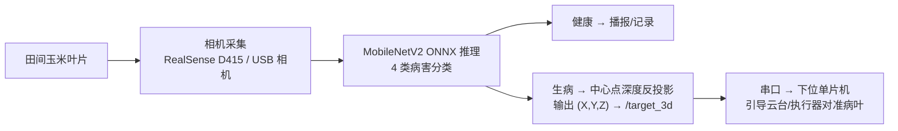

# 玉米医生 — AI+农业玉米病虫害识别与定位系统

> AIC-2026-46559581 · AI+农业赛道 · "玉米医生"

对玉米四大类病害（**叶斑病 Blight / 普通锈病 Common_Rust / 灰斑病 Gray_Leaf_Spot / 健康 Healthy**）进行识别的完整落地系统：PC 端训练与网页应用 + 树莓派 ROS 2 边缘部署（深度相机三维定位 + USB 相机手持机）。

最终模型在测试集（1257 张）上准确率 **90.2%**：

| Blight 叶斑病 | Common_Rust 普通锈病 | Gray_Leaf_Spot 灰斑病 | Healthy 健康 |
|---|---|---|---|
| 84.0% | 95.4% | 72.7% | 99.1% |

## 系统组成

| 模块 | 内容 | 技术 |
|---|---|---|
| 玉米病害数据集 | **4188 张**田间照片（train 2931 / test 1257），每张配 YOLO 格式标注 json | — |
| PC 端训练与识别代码 | 自建 CNN 对比实验（层数/Dropout/L2）→ MobileNetV2 迁移学习 → 测试集评估 → Flask 网页识别 → ONNX 导出 → USB 摄像头实时检测 | PyTorch、ONNX、Flask |
| 树莓派边缘部署 | ROS 2 工作空间 `corn_ws`，两个功能包 | ROS 2 Humble、ONNX Runtime、pyserial |

```
├── AIC-2026-46559581-AI+农业-玉米医生-玉米病害数据集/     # 8379 张数据集
├── AIC-2026-46559581-AI+农业-玉米医生-PC端训练与识别代码/  # 训练/评估/网页/导出源码 + 模型产物
│   ├── ...-源代码/          # 02~07 全流程脚本
│   ├── ...-网页模板/        # Flask 前端页面
│   └── ...-输出结果/        # 对比实验模型、最终模型(.pth/.onnx)、混淆矩阵等图表
└── AIC-2026-46559581-AI+农业-玉米医生-树莓派边缘部署/
    ├── ...-RealSense三维定位方案.md      # corn_detect: 深度相机三维坐标方案（文档）
    ├── ...-USB相机实物部署说明.md        # corn_doctor_ros2: 实物搭建指引（文档）
    └── corn_ws/src/
        ├── corn_detect/       # RealSense 深度相机: 病害识别 + 三维坐标输出 + 串口下发
        └── corn_doctor_ros2/  # USB 相机手持机: 采集 + 识别 + 结论发布
├── docs/                                # 在线资源：三维定位方案网页 + 浏览器端识别页 app.html（GitHub Pages）
├── server/                              # 识别后端（Flask + ONNX Runtime，POST /predict）
├── miniprogram-native/                  # ★ 微信小程序（原生，本地离线推理，无需后端）
├── miniprogram/                         # 微信小程序（Taro 4.1.9 + React + TS，走后端接口的早期版本）
└── deliverables/                        # 可交付成品快照（Flask 网页版 / 小程序源码 / RealSense 方案）
```

## 快速开始

### PC 端（训练 / 网页识别）

```bash
pip install -r "AIC-2026-46559581-AI+农业-玉米医生-PC端训练与识别代码/AIC-2026-46559581-AI+农业-玉米医生-依赖清单.txt"

# 网页识别（已附带训练好的最终模型）
python ".../AIC-2026-46559581-AI+农业-玉米医生-源代码/AIC-2026-46559581-AI+农业-玉米医生-05_网页识别应用.py"
# 浏览器打开 http://127.0.0.1:5000 上传叶片照片即可识别
```

### 树莓派端（边缘部署）

```bash
cd "AIC-2026-46559581-AI+农业-玉米医生-树莓派边缘部署/corn_ws"
colcon build --symlink-install && source install/setup.bash

# USB 相机手持机（corn_doctor_ros2）
ros2 launch corn_doctor_ros2 corn_doctor.launch.py

# RealSense 深度定位（corn_detect，输出 /target_3d 三维坐标并串口下发）
ros2 launch corn_detect detect.launch.py
```

详细说明：[RealSense三维定位方案](AIC-2026-46559581-AI+农业-玉米医生-树莓派边缘部署/AIC-2026-46559581-AI+农业-玉米医生-RealSense三维定位方案.md) · [USB相机实物部署说明](AIC-2026-46559581-AI+农业-玉米医生-树莓派边缘部署/AIC-2026-46559581-AI+农业-玉米医生-USB相机实物部署说明.md)

## 三种可直接体验的成品

### 1. 浏览器在线识别（无需安装）

<https://caic70456-glitch.github.io/corn-doctor/app.html>

打开即用：上传 / 拍照 / 点示例图 → 浏览器本地跑 ONNX 模型 → 输出四类概率与防治建议。照片不上传、不需要后端。

- 含**绿叶检测**：先算画面绿色像素占比与亮度，不是玉米叶片就提示重拍，不做病害判断
- 源码：[docs/app.html](docs/app.html)，推理引擎与模型自托管在 `docs/ort/`、`docs/models/`（避开 CDN 跨域问题）

### 2. 微信小程序（本地离线，无需后端）★

`miniprogram-native/` — 原生小程序，模型与推理全部内置在包里。

| 指标 | 数值 |
|---|---|
| 网络结构 | 4 层 3×3 卷积（3→16→32→64→64）+ BN + ReLU + GAP + FC |
| 输入 | 96×96 RGB |
| 参数量 | 约 60K（融合 BN 后 60,772 个 float32，237 KB） |
| 测试集准确率 | **92.12%** |
| 单张推理耗时 | 约 62 ms（PC 实测；手机约 100–300 ms） |
| 包体积 | 332 KB |
| 依赖 | 无。纯 JS 前向计算，`require` 权重即可 |

- 已开启 `lazyCodeLoading: "requiredComponents"`（组件按需注入）
- 绿叶检测与网页端同口径（HSV 绿色占比 ≥ 2%，亮度 ≥ 45）
- 训练 / 导出 / 校验脚本：`tools/train_lite.py`、`tools/make_js_assets.py`、`tools/verify_export.py`、`tools/test_inference.js`
- 已上传微信后台「开发版本 1.0.0」，AppID `wx5bcb65e8cce1d467`

> 小程序没有 `require(.json)` 能力，模型元数据必须是 `.js` 模块；权重用 base64 内联，避免 `readFileSync` 读代码包二进制文件的兼容性问题。

### 3. 方案介绍页（三维定位）

<https://caic70456-glitch.github.io/corn-doctor/> — 由 [docs/index.html](docs/index.html) 经 GitHub Pages 自动部署

## 备选：后端 + 上传识别（局域网）

早期方案，手机拍图后上传到电脑上的 Flask 服务识别。现已不作为主路径，保留供对比。

**后端服务（server/api.py，Flask + ONNX Runtime）**

```bash
pip install flask pillow numpy onnxruntime
python server/api.py
# 监听 0.0.0.0:5000
# 接口：POST /predict（multipart/form-data，字段 file=图片）  GET /health
```

**Taro 版小程序（miniprogram/，早期版本，走后端接口）**

- 3 个 Tab：**识别**（拍照/选图 → 上传后端 → 展示病害名、置信度、4 类概率条、症状与防治）/ **病害知识** / **关于**
- API 地址：编辑 `miniprogram/src/services/predict.ts` 中的 `API_BASE`，真机调试时改为运行后端的电脑局域网 IP（如 `http://192.168.1.10:5000`）
- 微信开发者工具需在"详情 → 本地设置"勾选"不校验合法域名、web-view（业务域名）、TLS 版本以及 HTTPS 证书"

```bash
cd miniprogram
npm install
npm run dev:weapp     # 产出 dist/，微信开发者工具导入该目录即可预览（需自备 AppID）
# 或发布构建: npm run build:weapp
```

## 素材索引（做 PPT / 答辩材料用）

### 关键数字

| 指标 | 数值 | 出处 |
|---|---|---|
| 数据集规模 | 4188 张田间照片（train 2931 / test 1257） | 数据集目录 |
| 类别分布（train） | 普通锈病 914 / 叶斑病 802 / 灰斑病 402 / 健康 813 | 文件名前缀统计 |
| 最终模型（MobileNetV2）测试集准确率 | **90.21%** | `...-测试评估报告.json` |
| 各类别准确率 | 叶斑病 84.01% / 普通锈病 95.41% / 灰斑病 72.67% / 健康 99.14% | 同上 |
| 小程序轻量模型测试集准确率 | **92.12%** | `miniprogram-native/utils/model_meta.js` → `testAcc` |
| 小程序包体积 | 332 KB | 开发者工具预览统计 |
| 单张推理耗时 | 62 ms（PC）/ 约 100–300 ms（手机） | `tools/test_inference.js` 实测 |

### 5 组对比实验（验证集最高准确率）

| 实验 | 结构 | Dropout | L2 | 验证准确率 |
|---|---|---|---|---|
| A 3层基准 | 3 blocks | 0.2 | 0 | 91.85% |
| B 3层高失活 | 3 blocks | 0.5 | 0 | 91.85% |
| C 3层L2正则 | 3 blocks | 0.2 | 1e-4 | **92.09%** |
| D 5层深网络 | 5 blocks | 0.2 | 0 | 91.13% |
| E 5层强正则 | 5 blocks | 0.5 | 1e-4 | 90.89% |

> 原始曲线数据：`...-输出结果\...-实验结果数据.json`

### 图表（可直接插入 PPT）

目录：`AIC-2026-46559581-AI+农业-玉米医生-PC端训练与识别代码\AIC-2026-46559581-AI+农业-玉米医生-输出结果\AIC-2026-46559581-AI+农业-玉米医生-结果图表\`

| 文件 | 建议用途 |
|---|---|
| `01_均方误差变化对比_不同层数与正则化.png` | 消融实验：正则化对 MSE 的影响 |
| `02_交叉熵损失对比_各实验.png` | 消融实验：损失曲线 |
| `03_验证准确率对比_各实验.png` | 消融实验：准确率曲线 |
| `04_各实验最终验证准确率_柱状图.png` | **一页讲完 5 组实验结论** |
| `05_最终模型训练历史曲线.png` | 最终模型收敛过程 |
| `06_混淆矩阵_测试集.png` | 错误分布（灰斑病最易混淆） |
| `07_归一化混淆矩阵_测试集.png` | 同上，按比例显示更好看 |
| `08_各类别准确率_测试集.png` | 四类准确率对比 |

### 可演示的在线成品

| 成品 | 链接 / 路径 |
|---|---|
| 浏览器识别页 | <https://caic70456-glitch.github.io/corn-doctor/app.html> |
| 三维定位方案页 | <https://caic70456-glitch.github.io/corn-doctor/> |
| 微信小程序 | 微信后台「开发版本 1.0.0」→ 选为体验版 → 扫码（AppID `wx5bcb65e8cce1d467`） |

### 代码与文档

| 内容 | 路径 |
|---|---|
| PC 端全流程脚本（01 数据 → 07 摄像头） | `...-源代码/` |
| 树莓派 RealSense 三维定位方案 | `...-树莓派边缘部署/...-RealSense三维定位方案.md` |
| 树莓派 USB 相机实物部署 | `...-树莓派边缘部署/...-USB相机实物部署说明.md` |
| 小程序离线模型训练脚本 | `miniprogram-native/tools/train_lite.py` |
| 小程序纯 JS 推理实现 | `miniprogram-native/utils/inference.js` |
| 浏览器端推理页 | `docs/app.html` |

## 工作原理



- 训练端预处理与边缘端推理预处理**逐位一致**（Resize224 → /255 → ImageNet 归一化 → RGB/CHW），类别顺序从 ONNX 元数据读取，杜绝训练/部署错位。
- 数据集为图片级标注，定位采用"整图分类 + 画面中心点反投影"方案；升级包围框检测后下游接口零改动。
