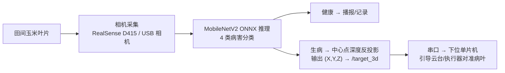

# 玉米医生 — AI+农业玉米病虫害识别与定位系统

> AIC-2026-46559581 · AI+农业赛道 · "玉米医生"

对玉米四大类病害（**叶斑病 Blight / 普通锈病 Common_Rust / 灰斑病 Gray_Leaf_Spot / 健康 Healthy**）进行识别的完整落地系统：PC 端训练与网页应用 + 树莓派 ROS 2 边缘部署（深度相机三维定位 + USB 相机手持机）。

最终模型在测试集（1257 张）上准确率 **90.2%**：

| Blight 叶斑病 | Common_Rust 普通锈病 | Gray_Leaf_Spot 灰斑病 | Healthy 健康 |
|---|---|---|---|
| 84.0% | 95.4% | 72.7% | 99.1% |

## 系统组成

| 模块 | 内容 | 技术 |
|---|---|---|
| 玉米病害数据集 | 8379 张田间照片，train/val/test 三分 | — |
| PC 端训练与识别代码 | 自建 CNN 对比实验（层数/Dropout/L2）→ MobileNetV2 迁移学习 → 测试集评估 → Flask 网页识别 → ONNX 导出 → USB 摄像头实时检测 | PyTorch、ONNX、Flask |
| 树莓派边缘部署 | ROS 2 工作空间 `corn_ws`，两个功能包 | ROS 2 Humble、ONNX Runtime、pyserial |

```
├── AIC-2026-46559581-AI+农业-玉米医生-玉米病害数据集/     # 8379 张数据集
├── AIC-2026-46559581-AI+农业-玉米医生-PC端训练与识别代码/  # 训练/评估/网页/导出源码 + 模型产物
│   ├── ...-源代码/          # 02~07 全流程脚本
│   ├── ...-网页模板/        # Flask 前端页面
│   └── ...-输出结果/        # 对比实验模型、最终模型(.pth/.onnx)、混淆矩阵等图表
└── AIC-2026-46559581-AI+农业-玉米医生-树莓派边缘部署/
    ├── ...-RealSense三维定位方案.md      # corn_detect: 深度相机三维坐标方案（文档）
    ├── ...-USB相机实物部署说明.md        # corn_doctor_ros2: 实物搭建指引（文档）
    └── corn_ws/src/
        ├── corn_detect/       # RealSense 深度相机: 病害识别 + 三维坐标输出 + 串口下发
        └── corn_doctor_ros2/  # USB 相机手持机: 采集 + 识别 + 结论发布
├── docs/                                # 三维定位方案网页版（GitHub Pages 自 docs/ 部署）
├── server/                              # 小程序识别后端（Flask + ONNX Runtime，POST /predict）
└── miniprogram/                         # 玉米病害识别微信小程序（Taro 4.1.9 + React + TypeScript）
```

## 快速开始

### PC 端（训练 / 网页识别）

```bash
pip install -r "AIC-2026-46559581-AI+农业-玉米医生-PC端训练与识别代码/AIC-2026-46559581-AI+农业-玉米医生-依赖清单.txt"

# 网页识别（已附带训练好的最终模型）
python ".../AIC-2026-46559581-AI+农业-玉米医生-源代码/AIC-2026-46559581-AI+农业-玉米医生-05_网页识别应用.py"
# 浏览器打开 http://127.0.0.1:5000 上传叶片照片即可识别
```

### 树莓派端（边缘部署）

```bash
cd "AIC-2026-46559581-AI+农业-玉米医生-树莓派边缘部署/corn_ws"
colcon build --symlink-install && source install/setup.bash

# USB 相机手持机（corn_doctor_ros2）
ros2 launch corn_doctor_ros2 corn_doctor.launch.py

# RealSense 深度定位（corn_detect，输出 /target_3d 三维坐标并串口下发）
ros2 launch corn_detect detect.launch.py
```

详细说明：[RealSense三维定位方案](AIC-2026-46559581-AI+农业-玉米医生-树莓派边缘部署/AIC-2026-46559581-AI+农业-玉米医生-RealSense三维定位方案.md) · [USB相机实物部署说明](AIC-2026-46559581-AI+农业-玉米医生-树莓派边缘部署/AIC-2026-46559581-AI+农业-玉米医生-USB相机实物部署说明.md)

## 小程序识别（移动端）

通过微信小程序拍照 / 选图，上传至本地识别后端实时推理，返回病害类别、置信度及防治建议。

**后端服务（server/api.py，Flask + ONNX Runtime）**

```bash
pip install flask pillow numpy onnxruntime
python server/api.py
# 监听 0.0.0.0:5000
# 接口：POST /predict（multipart/form-data，字段 file=图片）  GET /health
```

**微信小程序（miniprogram/，Taro 4.1.9 + React + TypeScript）**

- 3 个 Tab：**识别**（拍照/选图 → 上传后端 → 展示病害名、置信度、4 类概率条、症状与防治）/ **病害知识**（4 类症状与防治建议）/ **关于**（模型信息 + 后端配置 + 相关链接）
- API 地址：编辑 `miniprogram/src/services/predict.ts` 中的 `API_BASE`，真机调试时改为运行后端的电脑局域网 IP（如 `http://192.168.1.10:5000`）
- 微信开发者工具需在"详情 → 本地设置"勾选"不校验合法域名、web-view（业务域名）、TLS 版本以及 HTTPS 证书"

```bash
cd miniprogram
npm install
npm run dev:weapp     # 产出 dist/，微信开发者工具导入该目录即可预览（需自备 AppID）
# 或发布构建: npm run build:weapp
```

**方案网页版（在线可直接访问，无需部署）**

- 地址：<https://caic70456-glitch.github.io/corn-doctor/>
- 由 [docs/index.html](docs/index.html) 经 GitHub Pages 自动部署

## 工作原理



- 训练端预处理与边缘端推理预处理**逐位一致**（Resize224 → /255 → ImageNet 归一化 → RGB/CHW），类别顺序从 ONNX 元数据读取，杜绝训练/部署错位。
- 数据集为图片级标注，定位采用"整图分类 + 画面中心点反投影"方案；升级包围框检测后下游接口零改动。
